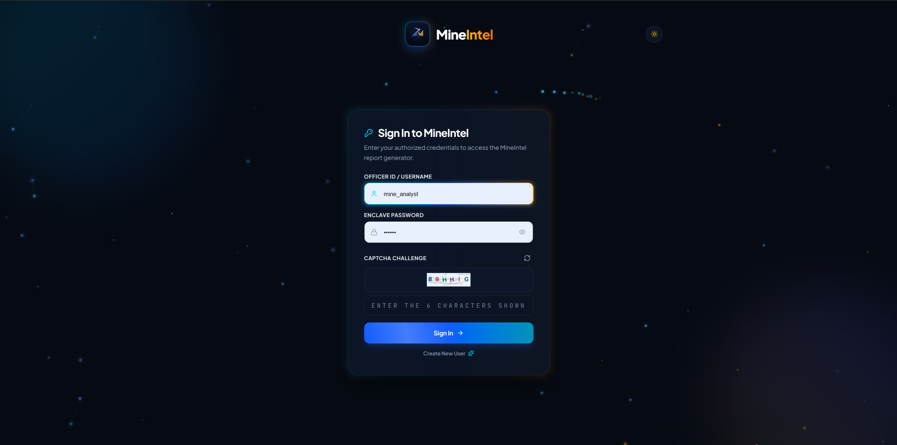
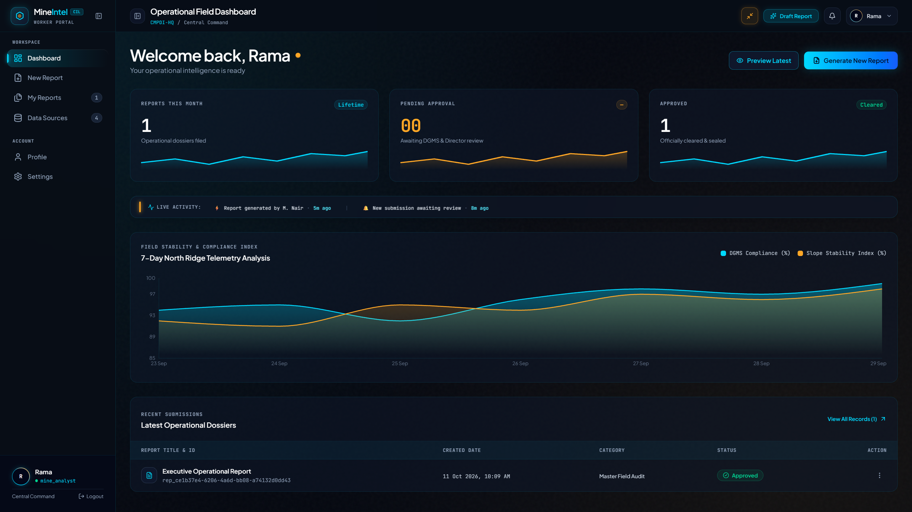
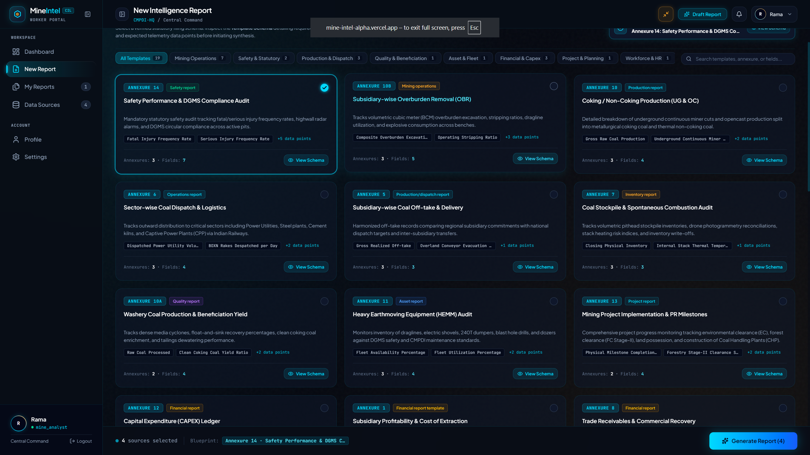
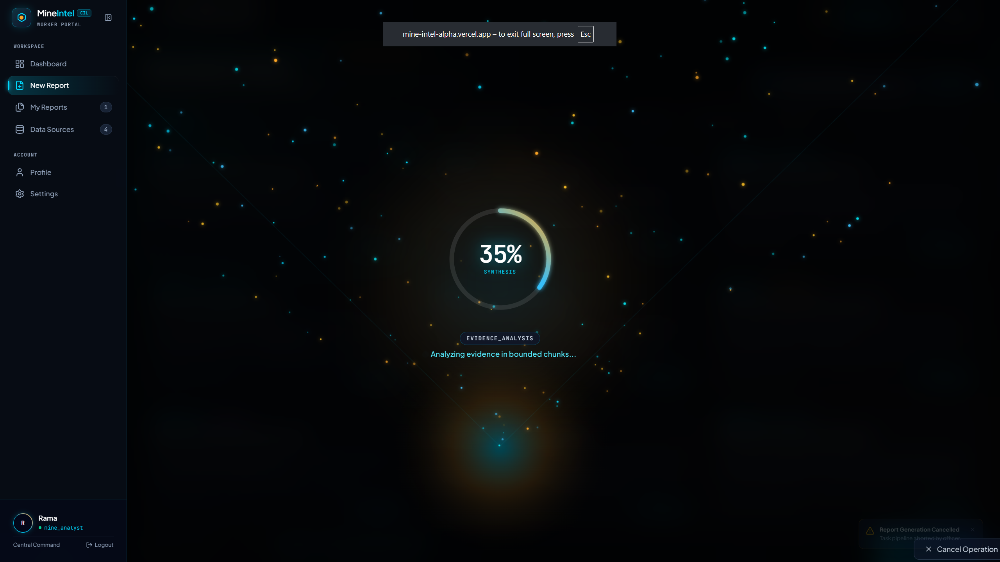
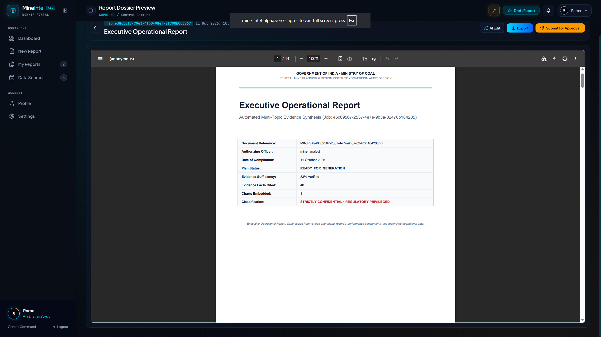
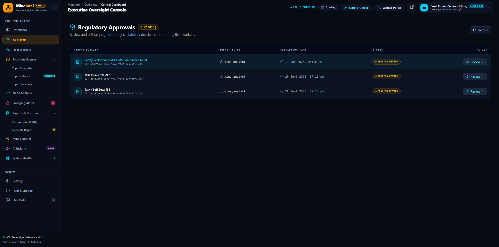

# 🏛️ MineIntel — AI-Powered Geological & Mining Report Intelligence
### Ministry of Coal · Central Mine Planning & Design Institute (CMPDI) · Coal India Limited

> An autonomous, sovereign document intelligence platform that 
> transforms raw operational documents into board-ready regulatory 
> dossiers with cryptographic provenance and zero hallucination.

[](https://fastapi.tiangolo.com)
[](https://react.dev)
[](https://vitejs.dev)
[](https://neon.tech)
[](https://groq.com)
[](https://ollama.com)
[](https://github.com)

---

**Live Deployments**
| Service | URL | Platform |
|---------|-----|----------|
| Frontend | https://mine-intel-alpha.vercel.app | Vercel |
| Backend API | https://mineintel-q0z7.onrender.com | Render |

**Demo Credentials**
| Role | Username | Password |
|------|----------|----------|
| Worker (Field Officer) | `mine_analyst` | `123456` |
| Master (Senior Officer) | `MOC-TEST-OFFICER-7890` | `Enclave@Auth#2026` |

⚠️ These are demo credentials for the hackathon prototype only. Change 
them in production via Render environment variables.

---

## 📸 Screenshots

### Login


### Worker Dashboard


### New Report (Template Selection)


### AI Processing Pipeline


### Report Preview (PDF)


### Master Approval Console


---

## 🎯 What It Does

MineIntel solves three problems for CIL/CMPDI:

1. **Document Intelligence** — Extracts structured facts from PDFs, 
   DOCX, XLSX, CSV, and scanned images with cryptographic provenance 
   (SHA-256 + byte offsets + bounding boxes).
2. **Regulatory Report Generation** — Uses a 10-stage deterministic 
   agent + Groq cloud LLM (or local Qwen 2.5) to synthesize statutory 
   dossiers grounded in extracted evidence.
3. **Approval Workflow** — Workers generate → submit for review → 
   Senior Officers approve/reject → status syncs both UIs in real time.

---

## 🏛️ Architecture

```
                                ┌──────────────────────────────────────────────┐
                                │          MINEINTEL ARCHITECTURE              │
                                └──────────────────────┬───────────────────────┘
                                                       │
                      ┌────────────────────────────────┴───────────────────────────────┐
                      │                                                                │
                      ▼                                                                ▼
         ┌──────────────────────────┐                                     ┌──────────────────────────┐
         │     WORKER WORKSTATION   │                                     │     MASTER CONSOLE       │
         │  (Field Officers & Eng.) │                                     │  (Senior Officers / DG)  │
         │   /worker/dashboard      │                                     │     /master/dashboard    │
         └────────────┬─────────────┘                                     └────────────┬─────────────┘
                      │                                                                │
                      └───────────────────────────────┬────────────────────────────────┘
                                                      │ HTTPS / JSON REST
                                                      ▼
                                       ┌─────────────────────────────┐
                                       │   REACT FRONTEND (Vercel)   │
                                       │ React 18, TypeScript, Vite, │
                                       │ Motion, Recharts, Tailwind  │
                                       └──────────────┬──────────────┘
                                                      │ HTTPS API Requests
                                                      │ HMAC Session Tokens + Nonces
                                                      ▼
                                       ┌─────────────────────────────┐
                                       │   FASTAPI BACKEND (Render)  │
                                       │ Python 3.11, Pydantic v2,   │
                                       │ Uvicorn, SQLAlchemy ORM     │
                                       └──────────────┬──────────────┘
                                                      │
         ┌────────────────────────────────────────────┼────────────────────────────────────────────┐
         │                                            │                                            │
         ▼                                            ▼                                            ▼
┌──────────────────────────┐             ┌──────────────────────────┐             ┌──────────────────────────┐
│   EVIDENCE INGESTION     │             │   DETERMINISTIC AGENT    │             │   DOSSIER SYNTHESIS      │
│ • pdfplumber & pypdf     │             │ • 10-Stage State Machine │             │ • ReportLab (300-DPI PDF)│
│ • python-docx & openpyxl │             │ • AST Math Engine        │             │ • python-docx (Word)     │
│ • Tesseract OCR & Pillow │             │ • Structured Error Traps │             │ • Matplotlib Charts      │
│ • SHA-256 Hash Auditing  │             │ • Section Semaphore Pool │             │ • Markdown Artifacts     │
└────────────┬─────────────┘             └────────────┬─────────────┘             └────────────┬─────────────┘
             │                                        │                                        │
             └────────────────────────────────────────┼────────────────────────────────────────┘
                                                      │
                                                      ▼
                       ┌──────────────────────────────────────────────────────────────┐
                       │                   AI REASONING DISPATCHER                    │
                       ├──────────────────────────────┬───────────────────────────────┤
                       │  PRIMARY (Cloud Deployment)  │  SOVEREIGN FALLBACK (Offline) │
                       │          Groq Cloud          │          Local Ollama         │
                       │   llama-3.3-70b-versatile    │         qwen2.5:7b            │
                       │     openai/gpt-oss-20b       │        qwen2.5vl:7b           │
                       └──────────────────────────────┴───────────────────────────────┘
                                                      │
                                                      ▼
                       ┌──────────────────────────────────────────────────────────────┐
                       │                  PERSISTENCE & PROVENANCE                    │
                       ├──────────────────────────────┬───────────────────────────────┤
                       │      Neon PostgreSQL         │        SQLite WAL Mode        │
                       │   (Serverless Production)    │       (Local Dev Fallback)    │
                       │ • Evidence Store (SHA-256)   │ • atomic user store           │
                       │ • Agent Task State & JSONB   │ • local documents table       │
                       │ • User Sessions & RBAC       │ • metrics.db audit log        │
                       └──────────────────────────────┴───────────────────────────────┘
```

### The 10-Stage Deterministic Agent Pipeline

Rather than relying on unbounded conversational loops, MineIntel enforces strict code governance over workflow transitions. Every report compilation progresses through 10 deterministic gates:

```
[1. LOAD_MANIFEST]
       │  Validates uploaded file manifest, mime types, file sizes, and access permissions.
       ▼
[2. VERIFY_INGESTION]
       │  Confirms document extraction, coordinates, text offsets, and cell tables.
       ▼
[3. EVIDENCE_ANALYSIS]
       │  Computes SHA-256 checksums, shreds facts, tags entities, and isolates colliery telemetry.
       ▼
[4. INTELLIGENCE_ANALYSIS]
       │  Resolves chronological timelines, detects metric conflicts, and clusters mining topics.
       ▼
[5. CHART_ANALYSIS]
       │  Identifies numerical trends, selects optimal chart templates, and renders vector figures.
       ▼
[6. PLANNING]
       │  Builds statutory report outline, maps required sections to relevant evidence items.
       ▼
[7. VALIDATE_PLAN]
       │  Verifies completeness of planned outline against mandatory CIL/CMPDI statutory standards.
       ▼
[8. WRITING]
       │  Executes semaphore-bounded parallel drafting via Groq/Qwen with strict evidence anchoring.
       ▼
[9. VALIDATE_REPORT_DATA]
       │  Integrity gate: Audits calculations via AST Math Engine and enforces evidence citations.
       ▼
[10. COMPILE_MARKDOWN_ARTIFACT]
       │  Assembles unified markdown dossier, injects dynamic vector figures and data tables.
       ▼
[VERIFY_ARTIFACT]
       │  Validates generated dossier against length, formatting, and mathematical consistency.
       ▼
  COMPLETED ──► Generated PDF (ReportLab) & Word (.docx) Dossiers Ready for Review
```

---

## 💻 Tech Stack

| Layer | Technologies | Purpose & Architecture Highlights |
|:------|:-------------|:----------------------------------|
| **Frontend** | React 18, TypeScript, Vite, TailwindCSS, Motion, Recharts, React Router, Lucide Icons | High-performance dual-role UI (Worker Workstation + Master Console), 60 FPS particle funnel processing visualizer, live status polling, interactive PDF/report preview, responsive dashboards. |
| **Backend** | Python 3.11, FastAPI, SQLAlchemy, Pydantic v2, Uvicorn | High-throughput asynchronous REST API, dependency injection, strict schema validation, modular feature routers (`auth`, `ingest`, `agent`, `metrics`, `admin`, `settings`). |
| **Database** | Neon PostgreSQL (serverless), SQLite (local fallback) | ACID-compliant persistent storage with JSONB state columns, connection pooling with SSL enforcement, atomic evidence records, and user session management. |
| **AI Inference** | Groq Cloud (`llama-3.3-70b-versatile` / `openai/gpt-oss-20b`) · Local Ollama (`qwen2.5:7b` / `qwen2.5vl:7b`) | Sub-second ultra-fast cloud inference on Groq for live deployments; air-gapped sovereign fallback with local Ollama for zero-cloud data egress in secure mining colliery enclaves. |
| **Document Processing** | pdfplumber, pypdf, python-docx, openpyxl, Pillow, Tesseract OCR | Comprehensive multi-format extraction engine handling scanned geological maps, dense Excel dispatch logs, Word templates, and technical reports with exact coordinate and byte offsets. |
| **Report Generation** | ReportLab 4.x (PDF), python-docx (Word), Matplotlib | Dual-pass canvas PDF compiler with dynamic `"Page X of Y"` footers, corporate Gold & Deep Navy palette, confidential watermarks, editable Word documents, and publication-grade charts. |
| **Auth & Security** | HMAC-signed session tokens, PBKDF2/bcrypt hashing, SVG CAPTCHA challenge | Cryptographic session tokens, per-user salted password hashing (100,000 rounds), procedural SVG CAPTCHA with bezier curves and noise interference to eliminate automated bot assaults. |

---

## 🚀 Local Development

### Prerequisites
- **Python 3.11+** installed
- **Node.js 18+** & `npm`
- **Tesseract OCR** (optional, for scanned images/OCR)
- **Ollama** (optional, for local offline AI mode)

---

### Backend Setup

```bash
# 1. Create and activate a virtual environment
python -m venv venv
venv\Scripts\activate  # Windows (or: source venv/bin/activate on Linux/macOS)

# 2. Install Python dependencies
pip install -r requirements.txt

# 3. Configure environment variables
copy .env.example .env

# Edit .env with your DATABASE_URL and GROQ_API_KEY
# 4. Start the FastAPI development server
uvicorn backend.main:app --host 127.0.0.1 --port 8000 --reload
```

The backend API will be live at `http://127.0.0.1:8000` with interactive Swagger docs at `http://127.0.0.1:8000/docs`.

---

### Frontend Setup

In a separate terminal:

```bash
# 1. Install frontend dependencies
npm install

# 2. Start Vite development server
npm run dev
```

Open `http://localhost:5173` in your browser to launch the MineIntel Portal.

---

### AI Configuration: Switching Between Groq and Ollama

MineIntel supports seamless switching between Cloud (Groq) and Local Sovereign (Ollama) inference via `.env`:

#### Option A: Groq Cloud (Recommended for Speed & Vercel/Render Deployments)
```env
MINEINTEL_AI_PROVIDER=groq
GROQ_API_KEY=your_groq_api_key_here
GROQ_MODEL=llama-3.3-70b-versatile
```

#### Option B: Local Sovereign Ollama (100% Offline / Zero Data Egress)
```env
MINEINTEL_AI_PROVIDER=local_ollama
OLLAMA_HOST=http://localhost:11434
MINEINTEL_LOCAL_MODEL=qwen2.5:7b
MINEINTEL_LOCAL_VL_MODEL=qwen2.5vl:7b
```

To pull the local models in Ollama:
```bash
ollama serve
ollama pull qwen2.5:7b
ollama pull qwen2.5vl:7b
```

---

## 📁 Repository Structure

```
MineIntel/
├── assets/
│   └── screenshots/              # UI walkthrough screenshots
├── backend/
│   ├── main.py                   # FastAPI application root & API router registry
│   ├── config.py                 # Central configuration & environment loader
│   ├── database.py               # SQLAlchemy models (Document, Neon/SQLite)
│   ├── auth_store.py             # Sovereign PBKDF2/bcrypt user store & RBAC
│   ├── routers/
│   │   ├── auth.py               # Authentication, CAPTCHA, sessions, profiles
│   │   ├── ingest.py             # Multi-format document upload & shredding
│   │   ├── agent.py              # 10-stage deterministic agent orchestration
│   │   ├── metrics.py            # Operational telemetry & system analytics
│   │   ├── admin.py              # Officer administration & system oversight
│   │   └── settings.py           # Runtime preferences & provider toggles
│   └── services/
│       ├── agent/                # AgentCoordinator, models, validators, tools
│       ├── ai_providers/         # Groq Cloud & Local Ollama provider adapters
│       ├── ingestion_service.py  # Ingestion shredder (PDF, DOCX, XLSX, CSV, OCR)
│       ├── evidence_store.py     # SHA-256 evidence indexing & search
│       ├── math_engine.py        # Python AST mathematical verification engine
│       ├── chart_service.py      # Statistical detection & Matplotlib rendering
│       ├── document_generator.py # ReportLab 300-DPI PDF & Word (.docx) compiler
│       └── report_editor_service.py # Revision tracking, diffs, & section editing
├── src/
│   ├── App.tsx                   # Top-level routing & role-based dispatch
│   ├── index.css                 # TailwindCSS design system & animations
│   ├── shared/                   # Shared authentication, context, & UI primitives
│   │   ├── components/           # LoginView, CAPTCHA inputs, AnimatedCursor
│   │   ├── context/              # AuthContext (JWT/HMAC session management)
│   │   └── services/             # API client & auth communication
│   ├── workerUi/                 # Field Officer Workstation
│   │   ├── WorkerApp.tsx         # Worker layout & sub-routes
│   │   ├── pages/                # Dashboard, DataSource, NewReport, MyReports,
│   │   │                         # ReportPreview, ReportExport, Profile, Settings
│   │   └── components/           # ProcessingOverlay, ReportTemplatesSection
│   └── masterUi/                 # Senior Officer Master Console
│       ├── MasterApp.tsx         # Master layout & sub-routes
│       ├── pages/                # DashboardPage, ApprovalsPage, ReportsPage,
│       │                         # AIInsightsPage, MineExplorerPage, WorkersPage,
│       │                         # TopicIntelligencePage, SystemHealthPage
│       └── components/           # Topbar, Sidebar, DocumentViewerModal
├── Dockerfile                    # Container definition for on-premise backend
├── docker-compose.yml            # Multi-service stack (Backend + Ollama)
├── requirements.txt              # Production Python dependencies
├── package.json                  # React & Vite frontend dependencies
└── README.md                     # Platform documentation
```

---

## 📡 Key API Endpoints

| Category | Method & Path | Description |
|:---------|:--------------|:------------|
| **System** | `GET /api/health` | Overall platform health & database connectivity |
| **System** | `GET /api/health/live` | Container liveness checkpoint |
| **System** | `GET /api/health/ready` | Readiness verification (DB, AI Provider, Models) |
| **Auth** | `GET /api/auth/captcha` | Procedural SVG CAPTCHA challenge generation |
| **Auth** | `POST /api/auth/login` | Officer authentication & HMAC session issuance |
| **Auth** | `GET /api/auth/verify` | Active session verification and role introspection |
| **Ingest** | `POST /api/ingest/upload` | Multipart file upload (PDF/DOCX/XLSX/CSV/Images) |
| **Ingest** | `GET /api/ingest/jobs` | Ingestion job manifests & extracted evidence facts |
| **Agent** | `POST /api/agent/tasks` | Launch 10-stage autonomous report generation |
| **Agent** | `GET /api/agent/tasks/{id}`| Poll real-time progress, stage name, & heartbeats |
| **Reports** | `GET /api/reports/{id}/pdf` | Stream 300-DPI publication-grade PDF dossier |
| **Reports** | `GET /api/reports/{id}/docx`| Download editable Word (.docx) document |
| **Approvals** | `POST /api/agent/tasks/{id}/review` | Master Officer review action (Approve / Reject) |

---

## 🔒 Security & Sovereign Governance

- **Zero Hallucination Guarantee:** The LLM is strictly constrained to synthesize narratives based on pre-extracted database evidence records (`[EVD-FACT-...]`, `[EVD-CALC-...]`).
- **AST Mathematical Integrity:** All sums, moving averages, standard deviations, and ratio fences are computed programmatically via Python Abstract Syntax Tree (AST) math algorithms before writing begins.
- **Cryptographic Provenance:** Every evidence record tracks source filename, SHA-256 digest, byte offset, cell coordinate, and extraction timestamp.
- **Role-Based Access Control (RBAC):** Strict separation between Worker (generation & submission) and Master (regulatory review, approval, rejection, and officer user administration).
- **Brute-Force & Bot Defense:** Procedural SVG CAPTCHA with bezier curve interference, dynamic cryptographic noise, and single-use challenge nonces.
- **Air-Gapped Sovereign Readiness:** Built to execute 100% offline inside private colliery local area networks using local Ollama (`qwen2.5:7b`).

---

## 👥 Smart India Hackathon (SIH 2026)

- **Organization:** Ministry of Coal, Government of India
- **Partner Enterprise:** Coal India Limited (CIL) & Central Mine Planning & Design Institute (CMPDI)
- **Problem Statement:** AI-Powered Automated Document Intelligence and Regulatory Reporting
- **Engineering Team:** MineIntel Core Engineering Group
